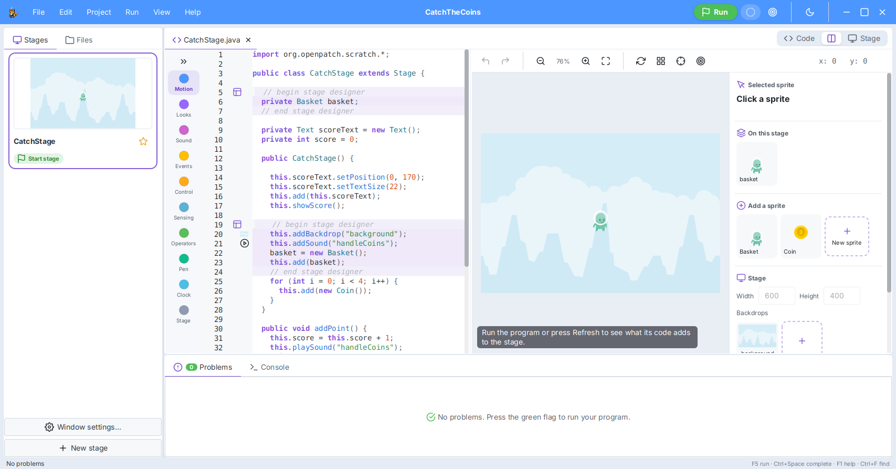

# Scratch for Java Studio

Scratch for Java Studio is a desktop IDE for students moving from Scratch to
Java. It builds projects with [Scratch for Java](https://github.com/openpatch/scratch-for-java)
and keeps them as ordinary Java source files that also work in BlueJ and VS Code.

**Status: 0.1.0-alpha.26.** The IDE and its
project format may change while we test it with students and teachers.



## Features

- Create a project from a starter, tutorial, or demo; open an existing project
  folder or import a Scratch `.sb3` project.
- Edit Java with completion, live diagnostics, beginner-friendly explanations
  in English and German, a Scratch block palette, and API help.
- Arrange stages and sprites in visual editors. Managed Java regions keep the
  visual editors and source code in sync while leaving other code editable.
- A class's tab reads left to right as in Scratch: the blocks, the code, the
  stage or sprite editor. The switch at the end of the tab strip shows the
  code, both side by side, or the visual editor alone.
- Edit images, sounds, sprite sheets, hitboxes, shaders, and Tiled maps.
- Drag images (PNG, JPG, GIF) and sounds (WAV, OGG, MP3, AIFF, AU) from your
  file manager onto the Files pane to copy them into the project. Existing
  files keep their contents; matching names get a number.
- Run programs in a separate JVM, use the console and debugger, and export a
  runnable JAR, a portable app folder, or a BlueJ/VS Code project ZIP.
- Save milestones and return to earlier work through Project → Versions. Versions use
  embedded Git, so no Git installation or setup is needed.

Student programs use the Scratch for Java library. The IDE does not replace or
modify that library.

Use Project → Save version to name a milestone and save all changes at once,
including code, images, sounds, libraries, and project settings. Build output,
caches, local history, and learning logs are excluded. Named versions are kept
when automatic history rotates.

Automatic run versions keep Java files, maps, tilesets, and shaders after the
program runs without crashing for a few seconds. Before restoring a version,
the current project is saved so you can undo the restore. These versions have
an `[AUTO]` prefix, and the newest 40 automatic versions are retained. Select
Hide automatic versions in the Versions dialog to see only your milestones.
The dialog can restore one file or the saved version's files, including binary
assets. Edit → Local history also keeps individual file revisions.

New repositories default to `main`. Versions live in the project's `.git` under `refs/scratch4j/versions/`, separate
from normal Git branches and the staging area. Old folder-based versions in
`.scratch4j/versions/` are imported automatically. Each version is an independent
commit; expired version refs are removed so Git garbage collection can reclaim
objects that are no longer used.

## Build and run from source

Install JDK 25 and Maven 3.9 or newer. A graphical desktop is needed to run
the IDE and student programs. On Linux, the stage designer's Refresh button
draws on an invisible screen when `xvfb-run` is installed (Arch:
`xorg-server-xvfb`, Debian and Ubuntu: `xvfb`); without it a window shows for a
moment.

```bash
mvn verify
mvn -pl app -am install -DskipTests
mvn -pl app exec:java
```

Run `exec:java` with `-pl app` only: the parent project has no main class.
After changing source code, repeat the `install` command and restart the IDE
so `exec:java` uses the updated modules in your local Maven repository.

## Package the alpha

Run the packaging script on the target operating system. It includes a
JetBrains Runtime for the IDE and student programs, so users do not need to
install a JDK. The same runtime supports enhanced hot reload.

```bash
scripts/package-ide.sh app-image  # portable application folder
scripts/package-ide.sh deb        # Linux package
scripts/package-ide.sh msi        # Windows installer, on Windows
scripts/package-ide.sh dmg        # macOS disk image, on macOS
```

The MSI adds a desktop shortcut and a Start menu entry in a "Scratch for Java"
folder; the DEB adds an applications menu entry under Development and Education.

Outputs are written to `target/package/`. The GitHub Actions
[`Package IDE`](.github/workflows/package.yml) workflow builds platform
artifacts when run manually or when an alpha tag is pushed. Packaging may
download the Scratch for Java library and a JetBrains Runtime. Signing and
notarization require the corresponding CI secrets.

The six Maven modules are `core` (projects and editing logic), `runner`
(separate JVM execution), `sound`, `export`, `ui` (JavaFX), and `app`
(entry point and packaging).

## License

The IDE is [MIT licensed](LICENSE). Bundled Scratch for Java artwork and sounds
come from [Kenney](https://kenney.nl) under CC0. OGG and MP3 support uses
replaceable LGPL libraries; RichTextFX, AtlantaFX, Ikonli, and Feather icons
retain their respective licenses.


## Continue between browser and desktop

Open a browser workspace JSON or portable project ZIP through the Project menu.
Export a Browser project ZIP to continue in an embedded IDE revision with ZIP
support. Code, assets, flavor and lesson identity travel with the project. NRW
course classes remain ordinary source on desktop and are retained in the browser.

Use Project > Import course pack for the offline tutorial/Spielwerkstatt pack.
Run > Run behavior checks executes transferred browser test classes with bundled
JUnit, leaving their source unchanged. Scratch imports have a Scratch migration
tab linking timing/unsupported-block tasks to the original block and Java source;
the original .sb3 remains in the project.

Run all checks locally with `scripts/test.sh`, or pick stages:

```sh
scripts/test.sh unit          # mvn verify (CI runs this on Linux, Windows and macOS)
scripts/test.sh smoke         # OpenGL, UI and export smoke (CI runs this on Linux)
scripts/test.sh integration   # release catalogs, course pack, browser transfer
```

Integration is local only: it uses sibling checkouts of `scratch-for-java` (at
the bundled release tag, via a temporary worktree), `hyperbook-informatik` and
`online-ide`; set `SCRATCH_LIBRARY`, `CURRICULUM` or `ONLINE_IDE` to use other
paths. Run it before a release or after changing templates, export or import.
The course check imports and compiles all 18 projects and runs the score tests.
Use `--libraries /path/to/bundled/library` for a fully offline check. The native
packaging workflow runs `scripts/smoke-packaged.py` on each supported OS. Local
Linux validation uses Xvfb when no display is available.

## Hints and behavior checks

Problems show one hint at a time: an explanation, the place to look, and an
analogous example or a focused fix preview. Arrows move between levels; closing
the hint frees the space again. Fixes still require their own click.
After three runs with the same error, the Hint button is highlighted. Lesson
steps support up to three hints per language and explain unmet class/method
checks. Teachers edit these in the lesson editor and can set `hintsOnly: true`
in project settings or a course manifest to hide automatic fix actions.

Run → Behavior checks shows a checklist in Problems with the teacher's
`@DisplayName` labels and plain assertion feedback. Failures link to student
stack frames when present; an assertion after a method has returned has no
student frame, so its raw trace remains available in the console.

## Learning log and privacy

Learning logs are **off by default**. A teacher can set `researchLog: true` in
`.scratch4j/project.json` or the course pack's `.scratch4j/course.json`.
The status bar shows when logging is on. File → Learning log lets students
read or delete their retained local log and explicitly **Hand in learning log**
as a separate file outside the project folder. Deleting stops logging until the project is opened again.
No events are uploaded automatically. School consent is collected outside the IDE.

Events record runs, compiler case keys/codes and line numbers, crashes, behavior
check outcomes, hint levels, help actions, lesson progress, view switches and
counts of inserted blocks and keyboard editing actions. Teacher-authored lesson and step IDs identify progress; palette IDs are hashed. Teacher-provided behavior check names
are recorded so the class report can name failing checks. No
source code, typed edits, file names, friendly titles, compiler messages,
assertion values or stack traces enter the log. Only file kinds are stored.

The local stream is `.scratch4j/log/events.jsonl`, capped at 2 MiB per segment
with three rotated segments. A random pseudonymous ID lives once in the OS
user's settings directory, never in `project.json`. On shared classroom accounts,
hand-in accepts a teacher-assigned pseudonym code for the submitted copy.
Share, browser, BlueJ and VS Code ZIPs exclude logs; app exports also exclude
`.scratch4j`. Teachers select a folder of deliberately handed-in files to copy
a class report through Help → For teachers → Copy class report. Reports derive metrics from the observed events; old rotated
history and periods outside an IDE session cannot be recovered.
See [the data-path decision](docs/learner-support-data-path.md) for details.

Printable common-error handouts: [English](docs/common-errors-en.html) and
[Deutsch](docs/common-errors-de.html). Regenerate both from the snippet corpus
with `mvn -pl core test -Dtest=CommonErrorsHandoutTest -Dscratch4j.handoutDir=../docs`.
